  

### `$ ls ~/projects --pinned`

  
  

  

### `$ cat contact`

`blog` → [CSDN](https://blog.csdn.net/2401_85922036) &nbsp;·&nbsp; `github` → [@AAAxianyu](https://github.com/AAAxianyu)

assets 由 <code>tools/gen.py</code> 生成，无第三方挂件。
